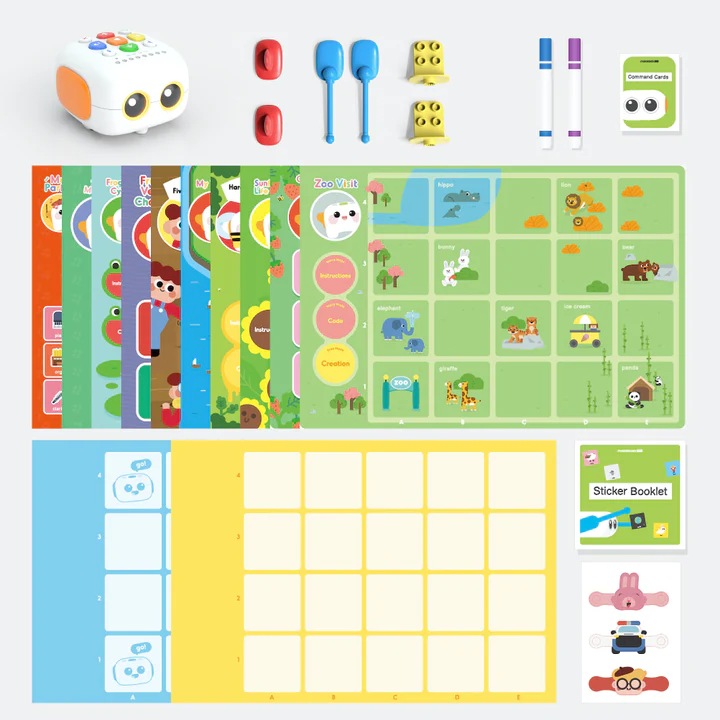
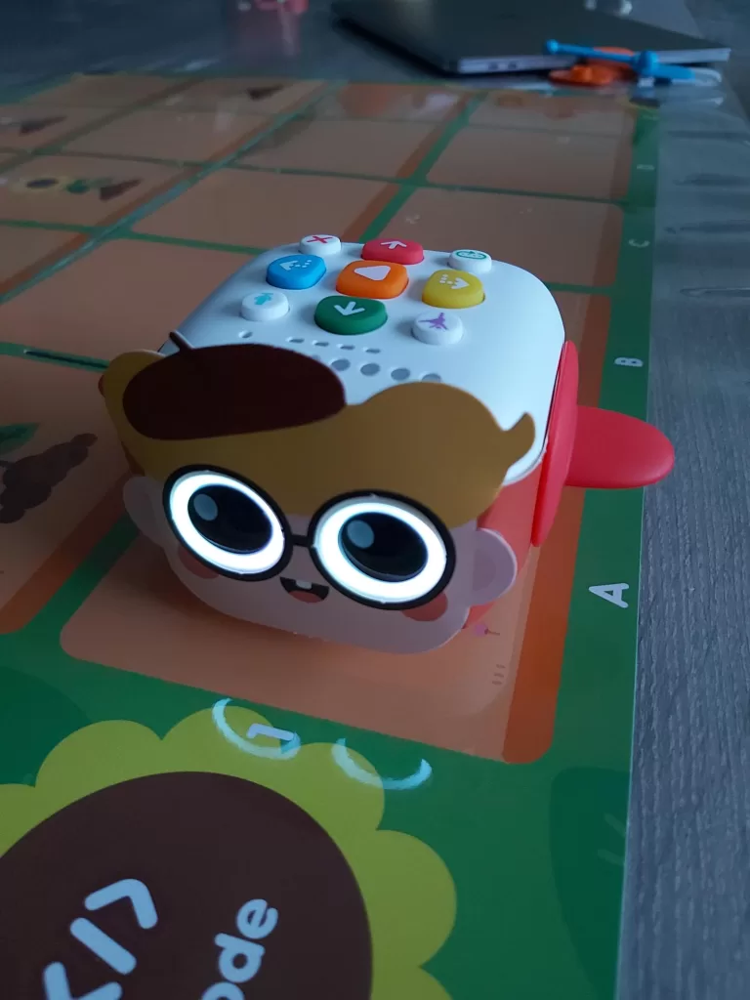

Du suchst einen ersten Roboter für dein Kind, möchtest ihm aber kein Tablet in die Hand geben? Der **Tale-Bot Pro** von [Matatalab](/de/marke-matatalab/) erfüllt genau diesen Wunsch. Es ist ein kleiner Roboter auf Rädern, den man direkt mit Tasten und Karten steuert, ganz ohne Bildschirm, und der illustrierte Geschichten begleitet, die auf dem Tisch oder auf einer Matte liegen.

In diesem Artikel erklären wir, was „Programmieren ohne Bildschirm“ bedeutet, was in der Box steckt, wie ein Kind seinen Roboter fahren lässt, was uns gefallen hat und was uns weniger überzeugt hat. Am Ende weißt du, ob dieser Roboter zu deinem Kind passt – und wohin du schauen kannst, wenn nicht.

## Programmieren ohne Bildschirm: worum geht es?

**Programmieren** (oder Codieren) heißt, einer Maschine eine Reihe genauer Befehle in der richtigen Reihenfolge zu geben, damit sie eine Aufgabe erledigt. Eine solche Reihe von Befehlen nennt man **Sequenz**: „Fahre ein Feld vor, biege rechts ab, fahre noch einmal vor.“

Bei den meisten Robotern für Kinder baut man diese Sequenz auf einem Tablet oder Computer. Beim Tale-Bot Pro geschieht alles mit den Fingern: Das Kind drückt Tasten und legt Karten, dann sieht es zu, wie der Roboter ausführt, was es gerade verlangt hat. Die ersten Grundideen des Programmierens (die Reihenfolge der Aktionen, einen Fehler erkennen und dann beheben) lernt man so spielerisch, stehend rund um einen Spielplan, ohne auf einen Bildschirm zu starren.

## Für welches Alter? Unsere Orientierung: 5 bis 9 Jahre

Matatalab stellt Kinder in den Vordergrund, die schon sehr früh das Programmieren entdecken. Wir geben eine genauere Orientierung, die auf dem beruht, was wir zu Hause gesehen haben.

- **Mit 4 Jahren** hat unser Sohn die Geschichten, das Zählen und die Formenspiele allein benutzt. Er liebt den Roboter, aber es ist eher geführtes Spiel als Programmieren: Der Roboter erzählt ihm etwas, und das Kind drückt die richtigen Tasten.
- **Von 5 bis 9 Jahren** kann das Kind mehrere Befehle aneinanderreihen, vorhersehen, wo der Roboter ankommt, und seine Sequenz korrigieren, wenn sich der Roboter im Feld irrt. Für diese Altersgruppe ist der Tale-Bot Pro als erster Programmierroboter am nützlichsten.
- **Nach 9 Jahren** wollen die meisten Kinder Sensoren, Blöcke auf dem Bildschirm oder einen Roboter, den sie selbst zusammenbauen. Dazu mehr im Abschnitt über die Grenzen.

Diese Altersgruppe entspricht unseren Labels „Ab 5 Jahren“: Von da an liest oder versteht das Kind eine einfache Anweisung und kann allein mit dem Roboter spielen. Unser Ratgeber [Lernroboter ab 5 Jahren](/de/lernroboter-5-jahre/) zeigt, wie sich andere Roboter nach Altersstufe einordnen, und der Ratgeber [Lernroboter mit 6 Jahren](/de/lernroboter-6-jahre/) geht den nächsten Schritt.

## Was in der Box steckt

Das folgende Foto, von Matatalab bereitgestellt, zeigt den Inhalt des Sets: den Roboter oben links, dann sein Zubehör, seine illustrierten Geschichtenpläne und seine Spielraster.

*Inhalt des Tale-Bot-Pro-Sets. Bild: Matatalab.*

Beim Auspacken kam die Lieferung in zwei Kartons. Der erste enthält den Roboter und sein Ladekabel. Insgesamt fanden wir:

- den **Tale-Bot Pro**, geladen und spielbereit geliefert, mit Ladekabel;
- mehrere **Arme und Zubehörteile**: Flügel, Arme, Halterungen, die mit Bausteinen vom Typ LEGO kompatibel sind, und Filzstifte;
- **drei Verkleidungen** zum Aufsetzen auf den Roboter (ein Hase, ein Polizist und ein kleiner Junge);
- illustrierte **Geschichten- und Aktivitätenpläne** sowie karierte Spielraster;
- einen **Einstellungsplan**, um die Sprache des Roboters und die Schrittweite zu wählen, 10 oder 15 Zentimeter;
- ein Heft mit wiederablösbaren **Stickern**, das wir nicht getestet haben, und die Anleitungen.

Der genaue Inhalt kann je nach Shop und Auflage variieren. Vergleiche vor dem Kauf die Liste im Angebot des Händlers mit der in diesem Artikel.

## Wie das Kind den Roboter programmiert

Der Tale-Bot Pro ist ein kleiner Roboter mit zwei Motoren, ausgestattet mit Lautsprecher, Lichtern, großen leuchtenden Augen und einem **optischen Sensor**, also einem kleinen Auge, das aufgedruckte Markierungen lesen kann. So erkennt er zum Beispiel die Flagge, die auf dem Sprachplan gewählt wurde.

*Der Tale-Bot Pro mit Verkleidung auf einem Geschichtenplan. Die Befehlstasten befinden sich auf der Oberseite des Roboters. Foto: Robot Éducatif.*

So läuft eine typische Sitzung ab, nach der Anleitung und nach dem, was wir beobachtet haben:

1. **Man wählt die Sprache** nur einmal: Der Roboter wird auf die passende Flagge des Plans gestellt und sagt in der gewählten Sprache seinen Gruß. Diese Einstellung bleibt beim Ausschalten gespeichert. Die einzelnen Schritte stehen kurz zusammengefasst in den häufigen Fragen unten.
2. **Man legt einen Plan aus** (zum Beispiel den Spaziergang im Zoo), auf dem die Felder von 10 oder 15 Zentimetern als Orientierung dienen.
3. **Das Kind stellt seine Strecke zusammen**, indem es die Richtungstasten des Roboters drückt: vorwärts, rückwärts, links abbiegen, rechts abbiegen. Jeder Tastendruck fügt der Sequenz einen Befehl hinzu.
4. **Es drückt die Starttaste**, und der Roboter führt die Sequenz Feld für Feld aus.
5. **Beobachten und korrigieren**: Kommt der Roboter nicht dort an, wo das Kind ihn erwartet hat, sucht man den falschen Befehl und ändert ihn. Dieser Schritt ist der wertvollste, denn er lehrt, einen Fehler zu finden, ohne sich entmutigen zu lassen.

Für die Kleinsten übernehmen geführte Aktivitäten. Es gibt vom Roboter erzählte Geschichten (der Spaziergang im Zoo, der Frosch und der Sonnenblumenkern), das Zählen, zum Beispiel sechs Erdbeeren wiederfinden, und Formenspiele. Bei der Zählaufgabe muss man daran denken, die Starttaste zu drücken, um seine Antwort zu prüfen: Unser Sohn brauchte etwas Zeit, um diese Geste zu verstehen.

## Unser Fazit: was uns gefallen hat, was weniger

Wir haben den Tale-Bot Pro kostenlos von Matatalab erhalten, ohne Bedingungen an den Inhalt dieses Artikels. Er wurde mehrere Tage lang mit einem 4-jährigen Kind getestet. Mit 8- oder 9-jährigen Kindern haben wir nicht getestet: Für diesen Teil der Altersspanne stützt sich unsere Einschätzung auf die Herstellerdokumentation und die Art der Aktivitäten.

| Kriterium | Unsere Einschätzung |
|---|---|
| Einstieg | Sehr gut. Der Roboter wird geladen geliefert, der Einstieg ist sofort möglich. Mit 4 Jahren war unser Sohn bei den Geschichten selbstständig. |
| Stimme und Ton | Klare, gut hörbare Stimme, auch in einem lebhaften Raum. |
| Vielfalt der Aktivitäten | Gut: Geschichten, Zählen, Formen, Tonaufnahmen, Verkleidungen. |
| Wert zum Programmierenlernen | Echt für die Grundlagen (Reihenfolge der Aktionen, einen Fehler korrigieren). Er bleibt auf Bewegungen beschränkt, ohne programmierbare Sensoren. |
| Robustheit | Die Verkleidungen wirkten empfindlich und begannen zu verschleißen. Über mehrere Monate Nutzung des Roboters selbst haben wir keine Erfahrung. |
| Wie lange er interessant bleibt | Gut zwischen etwa 4 und 7 Jahren. Danach kennt das Kind die Strecken schnell auswendig. |

**Die Stärken**: ein Start ohne Installation und ohne Konto, eine angenehme Stimme, fesselnde Geschichten (unser Sohn hat sich den Zoo-Spaziergang innerhalb einer Stunde mehrmals angehört), einfache Anweisungen und ein Spiel, das man zu mehreren spielen kann.

**Die Grenzen, die man kennen sollte**: Der Roboter bereitet nicht direkt auf die Programmierung mit Blöcken oder Python vor, denn es gibt weder Bildschirm noch fortgeschrittene Sensoren zum Programmieren. Die Verkleidungen sind empfindlich. Die Matatalab-App, die unter anderem dazu dient, die interne Software des Roboters zu aktualisieren, war bei unserem Test im Frühjahr 2023 nicht im Play Store von Android verfügbar: Prüfe ihre Verfügbarkeit, wenn du ein Android-Tablet nutzt. Für die Grundnutzung ist diese App nicht nötig.

**Unser Urteil**: Der Tale-Bot Pro ist ein sehr guter erster Roboter für ein Kind von 4 bis 7 Jahren, das die Idee entdeckt, Befehle in der richtigen Reihenfolge zu geben – ohne Bildschirm. Weniger geeignet ist er, wenn dein Kind schon über 8 Jahre alt ist und technischere Herausforderungen verlangt: Ein Roboter mit Sensoren bringt ihm dann mehr.

Der Preis schwankt je nach Zeitraum und Händler: Sieh dir am Bestelltag den im Amazon-Angebot angezeigten Preis an. Wenn du lieber beim Hersteller kaufst, schau in den offiziellen Shop auf der [Website von Matatalab](https://www.matatalab.com/) (der Online-Shop heißt heute MatataStudio), der eine beschränkte Garantie von einem Jahr nennt, die wir auf unserer [Seite zur Marke Matatalab](/de/marke-matatalab/) näher beschreiben.

[Tale-Bot Pro auf Amazon.de ansehen](https://www.amazon.de/dp/B09LYTM5BC?tag=roboteducat00-21)

*Affiliate-Link: Wenn du über diesen Link kaufst, erhält die Seite eine kleine Provision, ohne Mehrkosten für dich. Gleiche vor der Bestellung Fotos und Namen des Angebots mit dem Tale-Bot **Pro** ab.*

## Zwei weitere bildschirmfreie Roboter zum Vergleich

Der Tale-Bot Pro ist nicht der einzige Roboter, mit dem man ohne Bildschirm programmieren kann. Hier zwei weitere Ideen, ausführlicher im Ratgeber [Lernroboter mit 6 Jahren](/de/lernroboter-6-jahre/):

- **Botley 2.0 (Learning Resources)**: wird mit einer Fernbedienung mit Pfeilen gesteuert, ohne App und ohne Tablet. Er kann einer schwarzen Linie folgen und ein Hindernis erkennen, was die Idee der Bedingung einführt („wenn ich auf ein Hindernis treffe, dann drehe ich ab“). Er richtet sich an Kinder ab 5 Jahren. [Botley 2.0 auf Amazon.de ansehen](https://www.amazon.de/dp/B083T5G5ZK?tag=roboteducat00-21).
- **Code & Go Robot Mouse (Learning Resources)**: ein Brettspiel mit Labyrinth, Wänden, Tunneln und Aufgabenkarten, bei dem die Maus mit den Tasten auf ihrem Rücken programmiert wird. Eine günstige Lösung, ideal zum Spielen mit mehreren Kindern. [Code & Go Robot Mouse auf Amazon.de ansehen](https://www.amazon.de/dp/B01A5YMCH4?tag=roboteducat00-21).

Wähle den Tale-Bot Pro, wenn dein Kind Geschichten und Figuren mag, Botley, wenn du logischere Herausforderungen willst, und die Maus Code & Go, wenn du ein Geschenk mit kleinem Budget suchst, das sich Geschwister teilen können. Wenn dein Kind am Bildschirm mit bunten Blöcken programmieren möchte, ist der [mBot](/de/mbot-mein-erster-lernroboter/) ein natürlicher nächster Schritt, etwa mit 8 oder 9 Jahren.

## Häufige Fragen

### Braucht der Tale-Bot Pro ein Tablet, ein Smartphone oder ein Konto?

Zum Spielen nicht: Tasten und Karten genügen. Die Matatalab-App dient vor allem dazu, die interne Software des Roboters zu aktualisieren.

### Wie ändere ich die Sprache des Tale-Bot Pro?

Schalte den Roboter ein, stelle ihn auf die Flagge der gewünschten Sprache auf dem mitgelieferten Plan und warte, bis er in dieser Sprache seinen Gruß sagt. Der Plan bietet elf Sprachen, und die Einstellung bleibt beim Ausschalten erhalten.

### Ab welchem Alter kann man anfangen?

Unser Sohn hat mit 4 Jahren allein mit den Geschichten und dem Zählen gespielt. Um wirklich eine Sequenz zu programmieren, empfehlen wir eher 5 bis 9 Jahre. Bei den ersten Sitzungen hilft ein Erwachsener, besonders bei den Jüngsten.

### Was ist der Unterschied zu einem Roboter wie dem mBot?

Der Tale-Bot Pro wird mit Tasten und Karten ohne Bildschirm gesteuert und nicht mit einer Software programmiert. Der mBot wird mit Blöcken am Computer programmiert und hat Sensoren, was ab etwa 8 bis 10 Jahren besser passt.

### Ist der Tale-Bot Pro robust?

Der Roboter wirkte für die Nutzung durch ein 4-jähriges Kind gut gebaut, die Verkleidungen sind aber empfindlich. Langzeiterfahrung über mehrere Monate haben wir nicht. Räume sie nach jeder Sitzung weg.

### Wie viel kostet der Tale-Bot Pro?

Der Preis ändert sich je nach Händler und Zeitraum. Prüfe ihn im [Amazon.de-Angebot zum Tale-Bot Pro](https://www.amazon.de/dp/B09LYTM5BC?tag=roboteducat00-21) oder im offiziellen Shop, bevor du bestellst.

*Amazon-Partner — bei qualifizierten Käufen kann eine Provision anfallen, ohne Mehrkosten für dich.*
