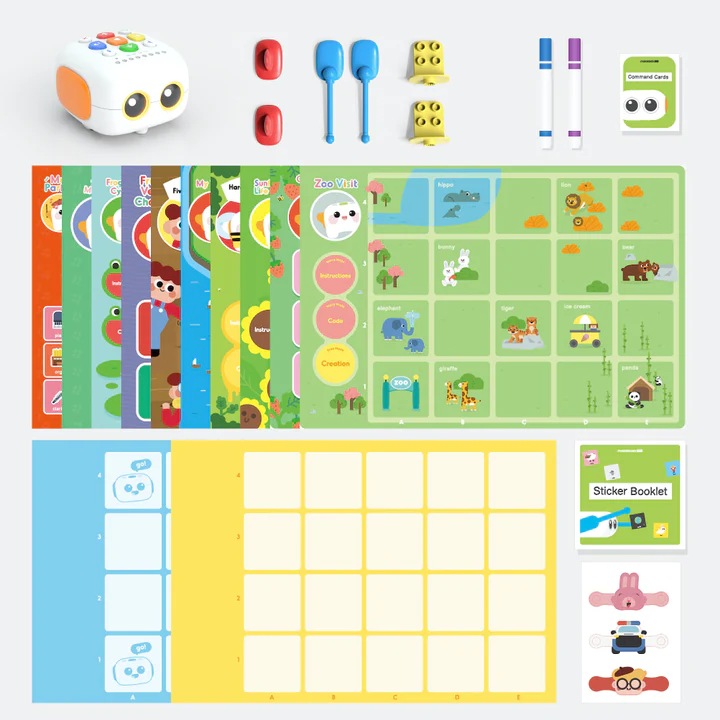
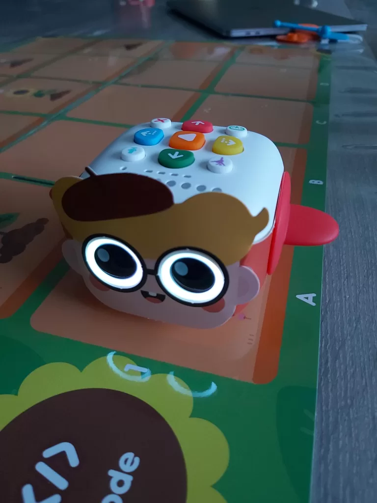

Are you looking for a first robot for your child, but you do not want to put a tablet in their hands? The **Tale-Bot Pro**, made by [Matatalab](/en/matatalab-brand/), answers that wish. It is a small wheeled robot that you control directly with keys and cards, with no screen, and that accompanies illustrated stories laid out on the table or on a mat.

In this article we explain what “coding without a screen” means, what is in the box, how a child makes the robot move, what we liked and what convinced us less. By the end you will know whether this robot suits your child, and what to look at if it does not.

## Coding without a screen: what does it mean?

**Coding**, or programming, means giving a machine a series of precise orders, in the right order, so that it carries out a task. Such a series of orders is called a **sequence**: “move forward one square, turn right, move forward again”.

With most robots for children, you build that sequence on a tablet or a computer. With the Tale-Bot Pro, everything happens with the fingers: the child presses keys and handles cards, then watches the robot carry out what they have just asked. The first ideas of coding (the order of actions, spotting a mistake and then fixing it) are learned by playing, standing around a map, without staring at a screen.

## What age? Our guideline: 5 to 9

Matatalab highlights children discovering coding at a very young age. We offer a more precise guideline, based on what we saw at home.

- **At 4**, our son used the stories, the counting and the shape games on his own. He loves the robot, but it is guided play more than programming: the robot tells him the story, and the child presses the right keys.
- **From 5 to 9**, the child can chain several orders, anticipate where the robot will end up and correct the sequence when the robot lands on the wrong square. This is the range for which the Tale-Bot Pro is most useful as a first programming robot.
- **After 9**, most children will want sensors, on-screen blocks or a robot they assemble themselves. We come back to this in the limits section.

This is the age range of our “From 5 years” labels: from there on, the child reads or understands a simple instruction and can enjoy the robot alone. Our guide to the [best robot for a 5-year-old](/en/best-robot-for-a-5-year-old/) explains how other robots fit into each age range, and the [best coding robot for a 6-year-old](/en/best-robot-for-a-6-year-old/) takes the next step.

## What is in the box

The photo below, supplied by Matatalab, shows the contents of the kit: the robot at the top left, then its accessories, its illustrated story maps and its game grids.

*Contents of the Tale-Bot Pro kit. Image: Matatalab.*

When we unpacked it, the delivery came in two boxes. The first holds the robot and its charging cable. Overall, we found:

- the **Tale-Bot Pro**, delivered charged and ready to play, with its charging cable;
- several **arms and accessories**: wings, arms, supports compatible with building bricks of the LEGO type, and felt pens;
- **three costumes** to put on the robot (a rabbit, a police officer and a little boy);
- illustrated **story and activity maps**, as well as square game grids;
- a **setup board** to choose the robot’s language and the size of its moves, 10 or 15 centimetres;
- a booklet of repositionable **stickers**, which we did not test, and the manuals.

The exact contents may vary depending on the shops and editions. Before buying, compare the list on the seller’s page with the one in this article.

## How the child programs the robot

The Tale-Bot Pro is a small two-motor robot fitted with a speaker, lights, big glowing eyes and an **optical sensor**, that is, a small eye able to read printed markers. That is how it recognises, for example, the flag chosen on the language board.

*The Tale-Bot Pro in a costume, standing on a story map. The command keys are on top of the robot. Photo: Robot Éducatif.*

Here is how a typical session goes, based on the manual and on what we observed:

1. **Choose the language** once: the robot is placed on the matching flag of the board, and it says its greeting in the selected language. This setting is kept when you switch the robot off. The steps are summarised in the FAQ below.
2. **Lay out a map** (for example the walk at the zoo), where the 10 or 15 centimetre squares serve as reference points.
3. **The child builds the route** by pressing the robot’s direction keys: forward, backward, turn left, turn right. Each press adds an order to the sequence.
4. **They press the play key** and the robot carries out the sequence, square after square.
5. **Observe and correct**: if the robot does not end up where the child expected, look for the wrong order and change it. This step is the most valuable, because it teaches how to find a mistake without getting discouraged.

For the youngest children, guided activities take over. There are stories told by the robot (the walk at the zoo, the frog and the sunflower seed), counting, for example finding six strawberries, and shape games. In the counting activity, you have to remember to press the play key to check your answer: our son needed a little time to understand that gesture.

## Our opinion: what we liked, what we liked less

We received the Tale-Bot Pro free of charge from Matatalab, with no conditions on the content of this article. It was tested for several days with a 4-year-old child. We did not test with 8 or 9-year-olds: for that part of the age range, our opinion relies on the manufacturer’s documentation and on the nature of the activities.

| Criterion | Our assessment |
|---|---|
| Getting started | Very good. The robot is delivered charged and use is immediate. At 4, our son was independent with the stories. |
| Voice and sound | Clear, audible voice, even in a lively room. |
| Variety of activities | Good: stories, counting, shapes, sound recording, costumes. |
| Value for learning to code | Real for the basics (order of actions, correcting a mistake). It stays limited to movements, with no sensors to program. |
| Sturdiness | The costumes seemed fragile and began to wear out. We have no experience of several months of use of the robot itself. |
| How long it holds interest | Good between about 4 and 7. Beyond that, the child quickly runs out of routes. |

**Strengths**: a start with no installation or account, a pleasant voice, stories that captivate (our son listened to the zoo walk several times in an hour), simple instructions and a game that works with several people.

**Limits to know about**: the robot does not directly prepare for block or Python programming, because there is no screen and no advanced sensors to program. The costumes are fragile. The Matatalab app, which is used in particular to update the robot’s internal software, was not available on Android’s Play Store during our test in spring 2023: check its availability if you use an Android tablet. Basic use does not need this app.

**Our verdict**: the Tale-Bot Pro is a very good first robot for a child aged 4 to 7 discovering the idea of giving orders in the right order, without a screen. It suits less if your child is already over 8 and wants more technical challenges: a robot with sensors will give them more.

The price varies over time and between sellers: check the price shown on the Amazon listing on the day you order. If you prefer to buy from the manufacturer, look at the official shop on the [Matatalab website](https://www.matatalab.com/) (the online shop is now called MatataStudio), which states a one-year limited warranty, detailed on our [Matatalab brand page](/en/matatalab-brand/).

[See the Tale-Bot Pro on Amazon UK](https://www.amazon.co.uk/dp/B09LYTM5BC?tag=roboteducatif-21) · [Amazon.com](https://www.amazon.com/dp/B09LYTM5BC?tag=roboteducatif-20)

*Affiliate links (UK first): if you buy through these links, the site earns a small commission at no extra cost to you. Match the listing’s photos and name to the Tale-Bot **Pro** before ordering.*

## Two other screen-free robots to compare

The Tale-Bot Pro is not the only robot that lets you code without a screen. Here are two other ideas, described in more detail in our guide to the [best coding robot for a 6-year-old](/en/best-robot-for-a-6-year-old/):

- **Botley 2.0 (Learning Resources)**: controlled with an arrow remote, with no app or tablet. It can follow a black line and detect an obstacle, which introduces the idea of a condition (“if I meet an obstacle, then I turn”). It is aimed at children aged 5 and over. [See Botley 2.0 on Amazon UK](https://www.amazon.co.uk/dp/B083T5G5ZK?tag=roboteducatif-21).
- **Code & Go Robot Mouse (Learning Resources)**: a board game with a maze, walls, tunnels and challenge cards, where the mouse is programmed with the buttons on its back. It is an economical solution, and ideal for playing with several children. [See Code & Go Robot Mouse on Amazon UK](https://www.amazon.co.uk/dp/B01A5YMCH4?tag=roboteducatif-21).

Choose the Tale-Bot Pro if your child likes stories and characters, Botley if you want more logical challenges, and the Code & Go mouse if you are looking for a low-budget gift to share between siblings. When your child wants to program on a screen with coloured blocks, the [mBot](/en/mbot-my-first-educational-robot/) is a natural next step, at around 8 or 9.

## Frequently asked questions

### Does the Tale-Bot Pro need a tablet, a smartphone or an account?

Not to play: the keys and the cards are enough. The Matatalab app is mainly used to update the robot’s internal software.

### How do I change the Tale-Bot Pro’s language?

Switch the robot on, place it on the flag of the chosen language on the supplied board and wait until it says its greeting in that language. The board offers eleven languages and the setting is kept when the robot is switched off.

### What age can a child start?

Our son played on his own with the stories and the counting at 4. To really program a sequence, we recommend 5 to 9 years old. An adult helps in the first sessions, especially with the youngest children.

### What is the difference with a robot like the mBot?

The Tale-Bot Pro is controlled with keys and cards, without a screen, and is not programmed with software. The mBot is programmed with blocks on a computer and has sensors, which suits children from about 8 to 10 better.

### Is the Tale-Bot Pro sturdy?

The robot seemed well built for a 4-year-old’s use, but the costumes are fragile. We have no experience over several months. Plan to put them away after every session.

### How much does the Tale-Bot Pro cost?

The price changes between sellers and over time. Check it on the [Amazon UK product page for the Tale-Bot Pro](https://www.amazon.co.uk/dp/B09LYTM5BC?tag=roboteducatif-21) or on the official shop before ordering.

*Amazon Associates — a commission may be earned on eligible purchases, at no extra cost to you.*
