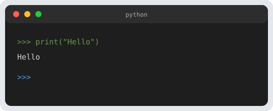

Some links on this page are affiliate links. The button opens Amazon so you can check today's price.

This project runs across **six articles**. You will code **Battleship** you can play in the **terminal**, reusing what you saw in the [Python track](/programmation/python/): lists, loops, `input`, functions, and conditions. Once the game runs, you can move it onto a Makeblock mBot2 or a Raspberry Pi 5 to show the grid on a screen or drive LEDs.

<a href="https://www.amazon.com/dp/B0919F9CKS?tag=roboteducatif-20" class="btn btn-action" rel="nofollow sponsored noopener" target="_blank">Check today's price on Amazon</a> (Makeblock mBot2)

<a href="https://www.amazon.com/dp/B0CK2FCG1K?tag=roboteducatif-20" class="btn btn-action" rel="nofollow sponsored noopener" target="_blank">Check today's price on Amazon</a> (Raspberry Pi 5)

**Suggested level**: comfortable through the articles on [lists](/python-listes-et-chaines/) and, ideally, [files](/python-fichiers-texte/) (optional, for saving a game later).



## 1. Rules you lock in for the code

Give yourself **clear** rules (you can change them later):

- A **10 × 10** grid (rows `0` to `9`, columns `0` to `9`).
- Five ships, lengths **5, 4, 3, 3, 2** cells (as in many classic sets).
- Ships sit in a **straight line**, **horizontal** or **vertical**, with no overlap. If you want the rule “a water square between two ships,” they must **not** touch along a side. To start, **side-by-side contact** is allowed (simpler to code). You can add a “one square of gap” condition later.
- Each turn, a player calls a square: **hit** or **miss**. If **every** cell of a ship is hit, you announce **sunk**.
- The game ends when **all** of one side’s ships are sunk.

## 2. Two grids per player

In practice, each player works with:

1. **Their “defense” grid**: where **their** ships are, and where the opponent has fired (water hit, or ship hit).
2. **Their “radar” grid** (often kept separate): what they know about the opponent’s area — squares **not yet played**, **misses**, and **hits**.

For learning, you represent both as **lists of lists** (matrices), the same size as the sea.

## 3. Symbols (project convention)

<div class="tableau empile">
<table>
<thead><tr>
<th scope="col">Symbol</th>
<th scope="col">Defense grid (my ships)</th>
</tr></thead><tbody>
<tr>
<td data-label="Symbol"><span class="td-val"><code>.</code></span></td>
<td data-label="Defense grid (my ships)"><span class="td-val">empty water</span></td>
</tr>
<tr>
<td data-label="Symbol"><span class="td-val"><code>#</code></span></td>
<td data-label="Defense grid (my ships)"><span class="td-val">part of a ship <strong>not yet hit</strong></span></td>
</tr>
<tr>
<td data-label="Symbol"><span class="td-val"><code>X</code></span></td>
<td data-label="Defense grid (my ships)"><span class="td-val">ship <strong>hit</strong></span></td>
</tr>
<tr>
<td data-label="Symbol"><span class="td-val"><code>o</code></span></td>
<td data-label="Defense grid (my ships)"><span class="td-val">opponent’s shot in the <strong>water</strong> (miss)</span></td>
</tr>
</tbody>
</table>
</div>

<div class="tableau empile">
<table>
<thead><tr>
<th scope="col">Symbol</th>
<th scope="col">Radar grid (what I know about the enemy)</th>
</tr></thead><tbody>
<tr>
<td data-label="Symbol"><span class="td-val"><code>?</code></span></td>
<td data-label="Radar grid (what I know about the enemy)"><span class="td-val">square not yet targeted</span></td>
</tr>
<tr>
<td data-label="Symbol"><span class="td-val"><code>O</code></span></td>
<td data-label="Radar grid (what I know about the enemy)"><span class="td-val"><strong>miss</strong> (confirmed)</span></td>
</tr>
<tr>
<td data-label="Symbol"><span class="td-val"><code>X</code></span></td>
<td data-label="Radar grid (what I know about the enemy)"><span class="td-val"><strong>hit</strong> (at least part of a ship)</span></td>
</tr>
</tbody>
</table>
</div>

The radar does not show where the hidden `#` cells are: only your own shots.

## 4. Finding a ship in memory

Besides the grid, it is very practical to store each ship as the **list of its coordinates** `(row, column)`. Example for a vertical destroyer at `(2, 3)`, `(3, 3)`:

```python
torpilleur = [(2, 3), (3, 3)]
flotte = [
    [(0, 0), (0, 1), (0, 2), (0, 3), (0, 4)],  # length 5
    # ... other ships
]
```

When the opponent fires at `(2, 3)`, you mark that square as hit on the grid **and** you can check whether **all** the cells of `torpilleur` are hit → **sunk**.

You will implement that logic in [parts 4 and 5](/en/python-battleship-4-shots/).

## 5. Constants worth creating now

You can already create a file `constantes.py`, or a header in your future `bataille.py`:

```python
TAILLE = 10
LONGUEURS_NAVIRES = [5, 4, 3, 3, 2]

VIDE = "."
NAVIRE = "#"
TOUCHE = "X"
MANQUE_DEFENSE = "o"

RADAR_INCONNU = "?"
RADAR_MANQUE = "O"
RADAR_TOUCHE = "X"
```

## 6. What you can do before part 2

Before you display the grid neatly:

1. Create a `10 × 10` list of lists filled with `VIDE`.
2. Check with a small `print` of one line (or two) that `len(grille) == 10` and `len(grille[0]) == 10`.

## Next

[Part 2 — Grid, display, and “A1-style” coordinates](/en/python-battleship-2-grid-display/): functions to create the sea, print it in the terminal, and turn `B7` into indexes.

## Full script for this chapter

```python
#!/usr/bin/env python3
# -*- coding: utf-8 -*-
"""
Battleship — Chapter 1/6: constants and empty grids (check).
Run: python bataille_chapitre_01.py
"""

TAILLE = 10
LONGUEURS_NAVIRES = [5, 4, 3, 3, 2]

VIDE = "."
NAVIRE = "#"
TOUCHE = "X"
MANQUE_DEFENSE = "o"

RADAR_INCONNU = "?"
RADAR_MANQUE = "O"
RADAR_TOUCHE = "X"


def nouvelle_grille_defense():
    return [[VIDE for _ in range(TAILLE)] for _ in range(TAILLE)]


def nouvelle_grille_radar():
    return [[RADAR_INCONNU for _ in range(TAILLE)] for _ in range(TAILLE)]


def main():
    g = nouvelle_grille_defense()
    assert len(g) == TAILLE and len(g[0]) == TAILLE
    r = nouvelle_grille_radar()
    nb_inconnues = sum(row.count(RADAR_INCONNU) for row in r)
    assert nb_inconnues == TAILLE * TAILLE
    print("OK — defense grid", TAILLE, "x", TAILLE, "filled with", repr(VIDE))
    print("OK — radar:", nb_inconnues, "squares", repr(RADAR_INCONNU))
    print("Ships to place (lengths):", LONGUEURS_NAVIRES)


if __name__ == "__main__":
    main()
```

## Download this chapter

**[bataille_chapitre_01.py](/downloads/bataille-navale/bataille_chapitre_01.py)** — the same content as the block above.

## Amazon

<a href="https://www.amazon.com/s?k=python+game+projects+book&tag=roboteducatif-20" class="btn btn-action" rel="nofollow sponsored noopener" target="_blank">Check today's price on Amazon</a>
