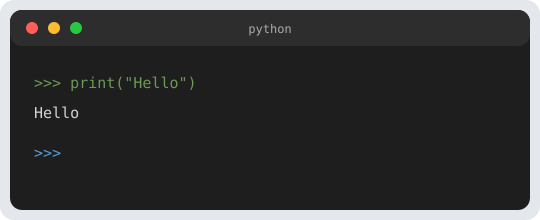

Some links on this page are affiliate links. The button opens Amazon so you can check today's price.

A readable **terminal** interface changes everything: the player sees the **masked word**, their **lives**, and the letters **already played** at a glance. This short article also adds a progressive **ASCII hangman** (optional, but motivating).



## 1. Turn header

```python
def afficher_etat(masque, vies, essayees):
    print("\n" + " ".join(masque))
    print(f"Lives: {vies}")
    print("Letters guessed:", " ".join(sorted(essayees)))
```

`sorted(essayees)` turns the set into a sorted list for display.

## 2. Hangman stages (7 mistakes → 7 drawings)

Store **7** multiline strings in a list `PENDU_ETAPES[0]` … `PENDU_ETAPES[6]`: at stage `k`, print `PENDU_ETAPES[k]` where `k = erreurs` (from 0 to 6). You can start with a minimal drawing:

```python
PENDU_ETAPES = [
    "",
    " O ",
    " O\n | ",
    " O\n/| ",
    " O\n/|\\\n",
    # ... fill in through stage 6
]
```

Each string can use **newline** characters `\n`. Test with `print(etape)`.

## 3. Keeping mistakes and lives in sync

If you start with **7 lives** and one mistake removes 1 life, the drawing to show can be `PENDU_ETAPES[7 - vies]` (indices 0 to 6).

## Exercises

1. Draw the **7 stages by hand** on paper, then turn them into strings.
2. Add a **`===` border** around the game screen to separate turns.
3. Hide the **exact** life count and show only a **bar** `█████░░` (5 blocks out of 7).

## Next

[Part 4 — Main loop and input checks](/en/python-hangman-4-game-loop/).

## Full script for this chapter

```python
#!/usr/bin/env python3
# -*- coding: utf-8 -*-
"""
Hangman — Chapter 3/6: display and ASCII hangman (7 stages).
Run: python pendu_chapitre_03.py
"""

import random
from pathlib import Path

BASE = Path(__file__).resolve().parent
CHEMIN_MOTS = BASE / "mots_pendu.txt"

PENDU_ETAPES = [
    "",
    " O ",
    " O\n | ",
    " O\n/| ",
    " O\n/|\\\n",
    " O\n/|\\\n/",
    " O\n/|\\\n/ \\",
]

VIES_MAX = 7


def charger_mots(chemin):
    with open(chemin, "r", encoding="utf-8") as f:
        lignes = f.read().splitlines()
    mots = [L.strip().upper() for L in lignes if L.strip()]
    if not mots:
        raise ValueError("No words in the file.")
    return mots


def afficher_etat(masque, vies, essayees):
    erreurs = VIES_MAX - vies
    etape = min(erreurs, len(PENDU_ETAPES) - 1)
    if PENDU_ETAPES[etape]:
        print(PENDU_ETAPES[etape])
    print("\n" + " ".join(masque))
    print(f"Lives: {vies}")
    print("Letters guessed:", " ".join(sorted(essayees)))


def main():
    try:
        mots = charger_mots(CHEMIN_MOTS)
    except FileNotFoundError:
        print("Put mots_pendu.txt next to the script.")
        return
    secret = random.choice(mots)
    masque = ["_"] * len(secret)
    essayees = set()
    vies = VIES_MAX
    afficher_etat(masque, vies, essayees)
    print("(Demo: one display only — the loop arrives in chapter 4.)")


if __name__ == "__main__":
    main()
```

## Download this chapter

**[pendu_chapitre_03.py](/downloads/pendu/pendu_chapitre_03.py)** — with **[mots_pendu.txt](/downloads/pendu/mots_pendu.txt)** in the same folder.

## On Amazon

A book search for Python exercises: [Check today's price on Amazon](https://www.amazon.com/s?k=python+exercises+book&tag=roboteducatif-20).
