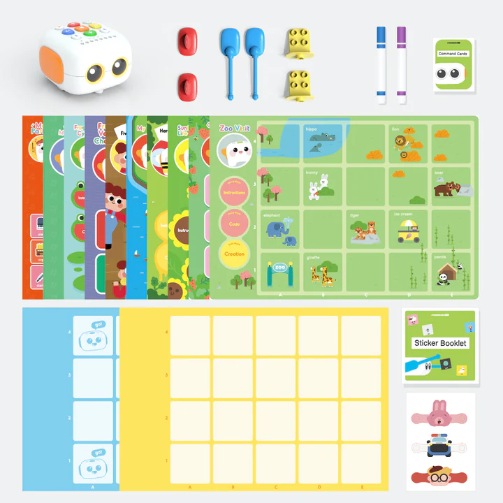
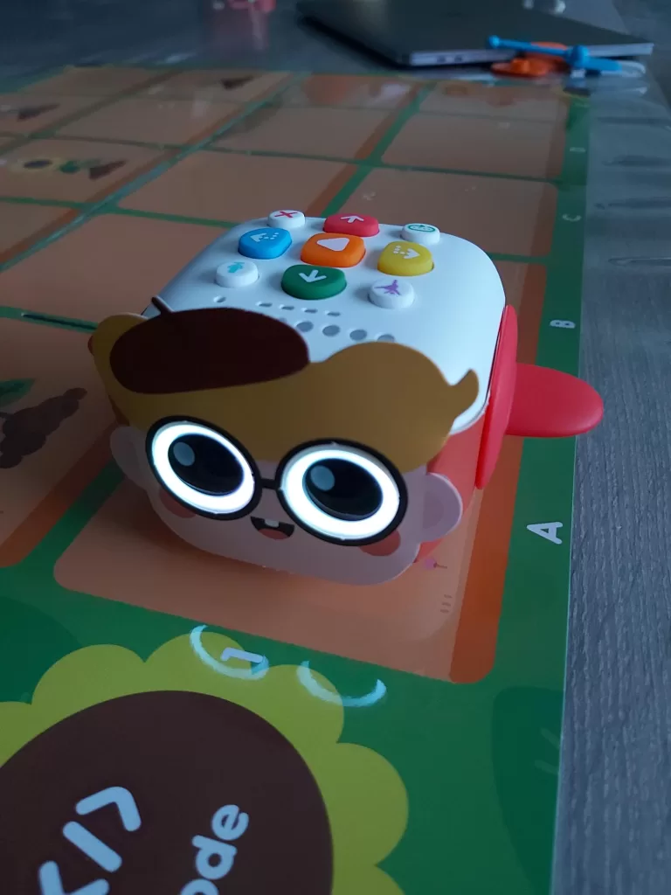

¿Buscas un primer robot para tu hijo, pero no quieres ponerle una tableta en las manos? El **Tale-Bot Pro**, fabricado por [Matatalab](/es/marca-matatalab/), responde a ese deseo. Es un pequeño robot con ruedas que se maneja directamente con teclas y cartas, sin pantalla, y que acompaña historias ilustradas colocadas sobre la mesa o sobre una alfombra.

En este artículo te explicamos qué significa «programar sin pantalla», qué contiene la caja, cómo hace avanzar un niño su robot, qué nos gustó y qué nos convenció menos. Al final sabrás si este robot encaja con tu hijo y hacia qué mirar si no es así.

## Programar sin pantalla: ¿de qué hablamos?

**Programar** (o codificar) es dar a una máquina una serie de órdenes precisas, en el orden correcto, para que realice una tarea. Una serie de órdenes así se llama **secuencia**: «avanza una casilla, gira a la derecha, avanza otra vez».

Con la mayoría de los robots para niños, esa secuencia se construye en una tableta o un ordenador. Con el Tale-Bot Pro todo ocurre con los dedos: el niño pulsa teclas y maneja cartas, y luego mira al robot ejecutar lo que acaba de pedirle. Las primeras nociones de programación (el orden de las acciones, el error que se detecta y luego se corrige) se aprenden así jugando, de pie alrededor de un plano y sin mirar fijamente una pantalla.

## ¿Para qué edad? Nuestra referencia: de 5 a 9 años

Matatalab destaca a los niños que descubren la programación a una edad muy temprana. Nosotros proponemos una referencia más precisa, basada en lo que vimos en casa.

- **A los 4 años**, nuestro hijo usó solo las historias, el recuento y los juegos de formas. Adora el robot, pero se trata más de juego guiado que de programación: es el robot quien le cuenta, y el niño pulsa las teclas correctas.
- **De 5 a 9 años**, el niño sabe encadenar varias órdenes, anticipar adónde llegará el robot y corregir su secuencia cuando el robot se equivoca de casilla. Es la franja en la que el Tale-Bot Pro resulta más útil como primer robot de programación.
- **Después de los 9 años**, la mayoría de los niños querrán sensores, bloques en pantalla o un robot que se monta uno mismo. Volvemos sobre ello en la parte de límites.

Esta franja de edad es la de nuestras etiquetas «A partir de 5 años»: desde ahí el niño lee o entiende una consigna sencilla y puede divertirse solo con el robot. Nuestra guía de [robot programable para 5 años](/es/robot-programable-5-anos/) explica cómo se sitúan los demás robots por franja de edad, y la de [robot programable para 6 años](/es/robot-programable-6-anos/) propone el siguiente paso.

## Qué contiene la caja

La foto de abajo, facilitada por Matatalab, muestra el contenido del kit: el robot arriba a la izquierda, luego sus accesorios, sus planos de historias ilustrados y sus cuadrículas de juego.

*Contenido del kit Tale-Bot Pro. Imagen: Matatalab.*

Cuando lo desembalamos, la entrega constaba de dos cajas. La primera contiene el robot y su cable de alimentación. En conjunto, encontramos:

- el **Tale-Bot Pro**, entregado cargado y listo para jugar, con su cable de carga;
- varios **brazos y accesorios**: alas, brazos, soportes compatibles con bloques de construcción tipo LEGO y rotuladores;
- **tres disfraces** para poner al robot (un conejo, un policía y un niño pequeño);
- **planos de historias y de actividades** ilustrados, además de cuadrículas de juego;
- un **tablero de ajustes** para elegir el idioma del robot y el tamaño de sus desplazamientos, 10 o 15 centímetros;
- un cuadernillo de **pegatinas** reposicionables, que no probamos, y los manuales.

El contenido exacto puede variar según las tiendas y las ediciones. Antes de comprar, compara la lista de la ficha del vendedor con la de este artículo.

## Cómo programa el niño el robot

El Tale-Bot Pro es un pequeño robot de dos motores, equipado con altavoz, luces, grandes ojos luminosos y un **sensor óptico**, es decir, un pequeño ojo capaz de leer marcas impresas. Así reconoce, por ejemplo, la bandera elegida en el tablero de idiomas.

*El Tale-Bot Pro con un disfraz, colocado sobre un plano de historia. Las teclas de mando están en la parte superior del robot. Foto: Robot Éducatif.*

Así transcurre una sesión tipo, según el manual y lo que observamos:

1. **Se elige el idioma** una sola vez: el robot se coloca sobre la bandera correspondiente del tablero y dice su saludo en el idioma seleccionado. Este ajuste queda guardado al apagar el robot. Los pasos se resumen en las preguntas frecuentes de más abajo.
2. **Se coloca un plano** (por ejemplo el paseo por el zoo), en el que las casillas de 10 o 15 centímetros sirven de referencia.
3. **El niño prepara su recorrido** pulsando las teclas de dirección del robot: avanzar, retroceder, girar a la izquierda, girar a la derecha. Cada pulsación añade una orden a la secuencia.
4. **Pulsa la tecla de reproducción** y el robot ejecuta la secuencia, casilla tras casilla.
5. **Se observa y se corrige**: si el robot no llega adonde el niño esperaba, se busca qué orden es errónea y se modifica. Esta etapa es la más valiosa, porque enseña a encontrar un error sin desanimarse.

Para los más pequeños, toman el relevo actividades guiadas. Hay historias contadas por el robot (el paseo por el zoo, la rana y la semilla de girasol), el recuento, por ejemplo encontrar seis fresas, y juegos de formas. En la actividad de recuento hay que acordarse de pulsar la tecla de reproducción para comprobar la respuesta: nuestro hijo necesitó un poco de tiempo para entender ese gesto.

## Nuestra opinión: lo que nos gustó y lo que nos gustó menos

Recibimos el Tale-Bot Pro gratis de parte de Matatalab, sin condiciones sobre el contenido de este artículo. Se probó durante varios días con un niño de 4 años. No hicimos pruebas con niños de 8 o 9 años: para esa parte de la franja de edad, nuestra opinión se apoya en la documentación del fabricante y en la naturaleza de las actividades.

| Criterio | Nuestra valoración |
|---|---|
| Puesta en marcha | Muy buena. El robot llega cargado y el manejo es inmediato. A los 4 años, nuestro hijo era autónomo con las historias. |
| Voz y sonido | Voz clara y audible, incluso en una habitación animada. |
| Variedad de actividades | Buena: historias, recuento, formas, grabación de sonidos, disfraces. |
| Valor para aprender a programar | Real para lo básico (orden de las acciones, corrección de un error). Se limita a los desplazamientos, sin sensores que programar. |
| Robustez | Los disfraces nos parecieron frágiles y empezaron a deteriorarse. No tenemos perspectiva de varios meses de uso del propio robot. |
| Duración del interés | Buena entre los 4 y los 7 años aproximadamente. Después, el niño agota enseguida los recorridos. |

**Los puntos fuertes**: un arranque sin instalación ni cuenta, una voz agradable, historias que cautivan (nuestro hijo volvió a escuchar el paseo por el zoo varias veces en una hora), consignas sencillas y un juego que se practica entre varios.

**Los límites que hay que conocer**: el robot no prepara directamente para la programación por bloques ni en Python, porque no hay pantalla ni sensores avanzados que programar. Los disfraces son frágiles. La aplicación de Matatalab, que sirve entre otras cosas para actualizar el software interno del robot, no estaba disponible en Google Play de Android durante nuestra prueba en la primavera de 2023: comprueba su disponibilidad si usas una tableta Android. El uso básico no necesita esta aplicación.

**Nuestro veredicto**: el Tale-Bot Pro es un muy buen primer robot para un niño de 4 a 7 años que descubre la idea de dar órdenes en el orden correcto, sin pantalla. Encaja menos si tu hijo ya tiene más de 8 años y reclama retos más técnicos: un robot con sensores le aportará más.

El precio varía según las épocas y los vendedores: consulta el precio que aparece en la ficha de Amazon el día en que pidas. Si prefieres comprar al fabricante, mira la tienda oficial en el [sitio de Matatalab](https://www.matatalab.com/) (la tienda en línea se llama hoy MatataStudio), que indica una garantía limitada de un año, detallada en nuestra [página sobre la marca Matatalab](/es/marca-matatalab/).

[Ver el Tale-Bot Pro en Amazon.es](https://www.amazon.es/dp/B09LYTM5BC?tag=roboteducat07-21)

*Enlace de afiliado: si compras a través de este enlace, el sitio recibe una pequeña comisión, sin coste adicional para ti. Antes de pedir, compara las fotos y el nombre del anuncio con el Tale-Bot **Pro**.*

## Otros dos robots sin pantalla para comparar

El Tale-Bot Pro no es el único robot que permite programar sin pantalla. Aquí van otras dos ideas, descritas con más detalle en nuestra guía del [robot programable para 6 años](/es/robot-programable-6-anos/):

- **Botley 2.0 (Learning Resources)**: se maneja con un mando de flechas, sin aplicación ni tableta. Puede seguir una línea negra y detectar un obstáculo, lo que introduce la idea de condición («si me encuentro un obstáculo, entonces giro»). Está pensado para niños de 5 años en adelante. [Ver Botley 2.0 en Amazon.es](https://www.amazon.es/dp/B083T5G5ZK?tag=roboteducat07-21).
- **Code & Go Robot Mouse (Learning Resources)**: un juego de mesa con laberinto, muros, túneles y cartas de retos, en el que el ratón se programa con los botones de su espalda. Es una solución económica e ideal para jugar entre varios. [Ver Code & Go Robot Mouse en Amazon.es](https://www.amazon.es/dp/B01A5YMCH4?tag=roboteducat07-21).

Elige el Tale-Bot Pro si a tu hijo le gustan las historias y los personajes, Botley si quieres retos más lógicos, y el ratón Code & Go si buscas un regalo de presupuesto reducido para compartir entre hermanos. Cuando tu hijo quiera programar en pantalla con bloques de colores, el [mBot](/es/mbot-mi-primer-robot-educativo/) es una etapa natural, hacia los 8 o 9 años.

## Preguntas frecuentes

### ¿El Tale-Bot Pro necesita una tableta, un smartphone o una cuenta?

No para jugar: bastan las teclas y las cartas. La aplicación de Matatalab sirve sobre todo para actualizar el software interno del robot.

### ¿Cómo se cambia el idioma del Tale-Bot Pro?

Enciende el robot, colócalo sobre la bandera del idioma elegido en el tablero suministrado y espera a que diga su saludo en ese idioma. El tablero ofrece once idiomas y el ajuste se conserva al apagar el robot.

### ¿A qué edad se puede empezar?

Nuestro hijo jugó solo con las historias y el recuento a los 4 años. Para programar de verdad una secuencia, aconsejamos más bien de 5 a 9 años. Un adulto ayuda en las primeras sesiones, sobre todo con los más pequeños.

### ¿Qué diferencia hay con un robot como el mBot?

El Tale-Bot Pro se maneja con teclas y cartas, sin pantalla, y no se programa con un software. El mBot se programa con bloques en el ordenador y tiene sensores, lo que encaja mejor a partir de 8 o 10 años.

### ¿Es resistente el Tale-Bot Pro?

El robot nos pareció bien diseñado para el uso de un niño de 4 años, pero los disfraces son frágiles. No tenemos perspectiva de varios meses. Conviene guardarlos después de cada sesión.

### ¿Cuánto cuesta el Tale-Bot Pro?

El precio cambia según los vendedores y las épocas. Consúltalo en la [ficha de Amazon.es del Tale-Bot Pro](https://www.amazon.es/dp/B09LYTM5BC?tag=roboteducat07-21) o en la tienda oficial antes de pedir.

*Socio de Amazon — puede generarse una comisión en compras elegibles, sin coste adicional para ti.*
