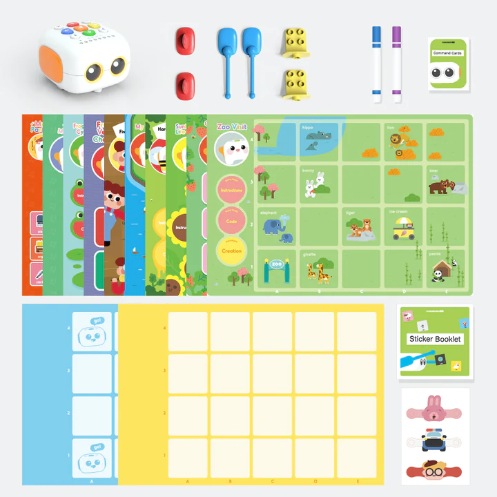
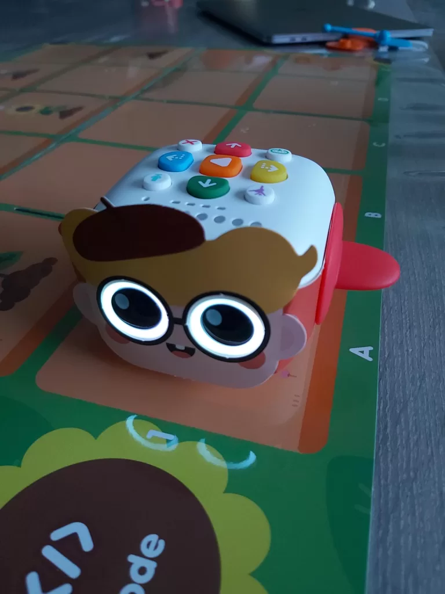

Cerchi un primo robot per tuo figlio, ma non vuoi mettergli in mano un tablet? Il **Tale-Bot Pro**, prodotto da [Matatalab](/it/marchio-matatalab/), risponde a questa esigenza. È un piccolo robot a ruote che si comanda direttamente con tasti e carte, senza schermo, e che accompagna storie illustrate appoggiate sul tavolo o su un tappeto.

In questo articolo ti spieghiamo cosa significa «programmare senza schermo», cosa contiene la scatola, come un bambino fa avanzare il suo robot, cosa ci è piaciuto e cosa ci ha convinti meno. Alla fine saprai se questo robot è adatto a tuo figlio e a cosa rivolgerti se non lo è.

## Programmare senza schermo: di cosa parliamo?

**Programmare** (o fare coding) significa dare a una macchina una serie di ordini precisi, nell’ordine giusto, perché svolga un compito. Una serie di ordini di questo tipo si chiama **sequenza**: «avanza di una casella, gira a destra, avanza ancora».

Con la maggior parte dei robot per bambini questa sequenza si costruisce su un tablet o un computer. Con il Tale-Bot Pro tutto avviene con le dita: il bambino preme i tasti e maneggia le carte, poi guarda il robot eseguire ciò che ha appena chiesto. Le prime nozioni di coding (l’ordine delle azioni, l’errore da individuare e poi correggere) si imparano così giocando, in piedi attorno a una mappa e senza fissare uno schermo.

## Per quale età? Il nostro riferimento: da 5 a 9 anni

Matatalab mette in evidenza i bambini che scoprono il coding in età molto precoce. Noi proponiamo un riferimento più preciso, basato su ciò che abbiamo visto a casa.

- **A 4 anni** nostro figlio ha usato da solo le storie, il conteggio e i giochi di forme. Ama il robot, ma si tratta più di gioco guidato che di programmazione: è il robot a raccontare, e il bambino preme i tasti giusti.
- **Da 5 a 9 anni** il bambino sa concatenare più ordini, prevedere dove arriverà il robot e correggere la sequenza quando il robot sbaglia casella. È la fascia per cui il Tale-Bot Pro è più utile come primo robot di programmazione.
- **Dopo i 9 anni** la maggior parte dei bambini vorrà sensori, blocchi sullo schermo o un robot da assemblare da soli. Ne riparliamo nella parte sui limiti.

Questa fascia d’età è quella delle nostre etichette «Da 5 anni»: da lì in poi il bambino legge o capisce una consegna semplice e può divertirsi da solo con il robot. La nostra guida al [robot programmabile a 5 anni](/it/robot-programmabile-5-anni/) spiega come si collocano gli altri robot per fascia d’età, mentre quella sul [robot programmabile a 6 anni](/it/robot-programmabile-6-anni/) propone il passo successivo.

## Cosa contiene la scatola

La foto qui sotto, fornita da Matatalab, mostra il contenuto del kit: il robot in alto a sinistra, poi i suoi accessori, le mappe illustrate delle storie e le griglie di gioco.

*Il contenuto del kit Tale-Bot Pro. Immagine: Matatalab.*

Quando l’abbiamo aperto, la consegna comprendeva due scatole. La prima contiene il robot e il suo cavo di alimentazione. Nel complesso abbiamo trovato:

- il **Tale-Bot Pro**, consegnato carico e pronto a giocare, con il suo cavo di ricarica;
- diversi **bracci e accessori**: ali, bracci, supporti compatibili con i mattoncini da costruzione tipo LEGO e pennarelli;
- **tre travestimenti** da mettere sul robot (un coniglio, un poliziotto e un bambino);
- **mappe di storie e attività** illustrate, oltre a griglie di gioco quadrettate;
- una **plancia di impostazione** per scegliere la lingua del robot e la lunghezza degli spostamenti, 10 o 15 centimetri;
- un libretto di **adesivi** riposizionabili, che non abbiamo provato, e i manuali.

Il contenuto esatto può variare a seconda dei negozi e delle edizioni. Prima di acquistare, confronta l’elenco della scheda del venditore con quello di questo articolo.

## Come il bambino programma il robot

Il Tale-Bot Pro è un piccolo robot a due motori, dotato di altoparlante, luci, grandi occhi luminosi e un **sensore ottico**, cioè un piccolo occhio capace di leggere segni stampati. È così che riconosce, per esempio, la bandiera scelta sulla plancia delle lingue.

*Il Tale-Bot Pro con un travestimento, posato su una mappa di storia. I tasti di comando si trovano sulla parte superiore del robot. Foto: Robot Éducatif.*

Ecco come si svolge una sessione tipo, secondo il manuale e ciò che abbiamo osservato:

1. **Si sceglie la lingua** una sola volta: il robot viene appoggiato sulla bandiera corrispondente della plancia e pronuncia il suo saluto nella lingua selezionata. L’impostazione resta memorizzata quando si spegne il robot. I passaggi sono riassunti nelle domande frequenti qui sotto.
2. **Si stende una mappa** (per esempio la passeggiata allo zoo), sulla quale le caselle da 10 o 15 centimetri fanno da riferimento.
3. **Il bambino prepara il suo percorso** premendo i tasti di direzione del robot: avanti, indietro, gira a sinistra, gira a destra. Ogni pressione aggiunge un ordine alla sequenza.
4. **Preme il tasto di avvio** e il robot esegue la sequenza, casella dopo casella.
5. **Si osserva e si corregge**: se il robot non arriva dove il bambino si aspettava, si cerca quale ordine è sbagliato e lo si modifica. Questa fase è la più preziosa, perché insegna a trovare un errore senza scoraggiarsi.

Per i più piccoli subentrano le attività guidate. Ci sono le storie raccontate dal robot (la passeggiata allo zoo, la rana e il seme di girasole), il conteggio, per esempio ritrovare sei fragole, e i giochi di forme. Nell’attività di conteggio bisogna ricordarsi di premere il tasto di avvio per verificare la risposta: nostro figlio ha avuto bisogno di un po’ di tempo per capire questo gesto.

## Il nostro parere: cosa ci è piaciuto, cosa meno

Abbiamo ricevuto il Tale-Bot Pro gratuitamente da Matatalab, senza alcuna condizione sul contenuto di questo articolo. È stato provato per diversi giorni con un bambino di 4 anni. Non abbiamo fatto prove con bambini di 8 o 9 anni: per questa parte della fascia d’età il nostro parere si basa sulla documentazione del produttore e sulla natura delle attività.

| Criterio | Il nostro giudizio |
|---|---|
| Primo utilizzo | Ottimo. Il robot arriva carico e l’uso è immediato. A 4 anni nostro figlio era autonomo con le storie. |
| Voce e suono | Voce chiara e udibile, anche in una stanza vivace. |
| Varietà delle attività | Buona: storie, conteggio, forme, registrazione di suoni, travestimenti. |
| Valore per imparare a programmare | Reale per le basi (ordine delle azioni, correzione di un errore). Resta limitato agli spostamenti, senza sensori da programmare. |
| Robustezza | I travestimenti ci sono sembrati fragili e hanno iniziato a rovinarsi. Non abbiamo esperienza di diversi mesi di uso del robot stesso. |
| Durata dell’interesse | Buona tra i 4 e i 7 anni circa. Oltre, il bambino ha presto esaurito i percorsi. |

**I punti di forza**: un avvio senza installazione né account, una voce gradevole, storie che catturano (nostro figlio ha riascoltato la passeggiata allo zoo più volte in un’ora), consegne semplici e un gioco che si pratica in più persone.

**I limiti da conoscere**: il robot non prepara direttamente alla programmazione a blocchi né in Python, perché non ci sono né schermo né sensori avanzati da programmare. I travestimenti sono fragili. L’app Matatalab, che serve tra l’altro ad aggiornare il software interno del robot, non era disponibile sul Play Store di Android durante la nostra prova nella primavera 2023: verifica la sua disponibilità se usi un tablet Android. L’uso di base non richiede questa app.

**Il nostro verdetto**: il Tale-Bot Pro è un ottimo primo robot per un bambino da 4 a 7 anni che scopre l’idea di dare ordini nell’ordine giusto, senza schermo. Va meno bene se tuo figlio ha già più di 8 anni e chiede sfide più tecniche: un robot con sensori gli darà di più.

Il prezzo varia a seconda dei periodi e dei venditori: consulta il prezzo indicato sulla scheda Amazon il giorno in cui ordini. Se preferisci acquistare dal produttore, guarda il negozio ufficiale sul [sito di Matatalab](https://www.matatalab.com/) (il negozio online oggi si chiama MatataStudio), che indica una garanzia limitata di un anno, descritta nella nostra [pagina sul marchio Matatalab](/it/marchio-matatalab/).

[Vedi il Tale-Bot Pro su Amazon.it](https://www.amazon.it/dp/B09LYTM5BC?tag=roboteducat0f-21)

*Link di affiliazione: se acquisti tramite questo link, il sito riceve una piccola commissione, senza costi aggiuntivi per te. Prima di ordinare, confronta foto e nome dell’annuncio con il Tale-Bot **Pro**.*

## Altri due robot senza schermo da confrontare

Il Tale-Bot Pro non è l’unico robot che permette di programmare senza schermo. Ecco altre due idee, descritte più in dettaglio nella guida al [robot programmabile per 6 anni](/it/robot-programmabile-6-anni/):

- **Botley 2.0 (Learning Resources)**: si comanda con un telecomando a frecce, senza app né tablet. Può seguire una linea nera e rilevare un ostacolo, il che introduce l’idea di condizione («se incontro un ostacolo, allora giro»). È pensato per bambini dai 5 anni. [Vedi Botley 2.0 su Amazon.it](https://www.amazon.it/dp/B083T5G5ZK?tag=roboteducat0f-21) · [tutte le offerte Botley 2.0](https://www.amazon.it/s?k=Learning+Resources+Botley+2.0&tag=roboteducat0f-21).
- **Code & Go Robot Mouse (Learning Resources)**: un gioco da tavolo con labirinto, muri, tunnel e carte sfida, in cui il topo si programma con i pulsanti sulla schiena. È una soluzione economica e ideale per giocare in più bambini. [Vedi Code & Go Robot Mouse su Amazon.it](https://www.amazon.it/dp/B01A5YMCH4?tag=roboteducat0f-21).

Scegli il Tale-Bot Pro se tuo figlio ama le storie e i personaggi, Botley se vuoi sfide più logiche e il topo Code & Go se cerchi un regalo a basso costo da condividere tra fratelli e sorelle. Quando tuo figlio avrà voglia di programmare sullo schermo con blocchi colorati, l’[mBot](/it/mbot-il-mio-primo-robot-educativo/) è un passo naturale, verso gli 8 o 9 anni.

Per conoscere meglio il produttore: [Matatalab, un’impresa innovativa (in francese)](/matatalab-une-entreprise-innovante/).

## Domande frequenti

### Il Tale-Bot Pro ha bisogno di un tablet, di uno smartphone o di un account?

Non per giocare: bastano i tasti e le carte. L’app Matatalab serve soprattutto ad aggiornare il software interno del robot.

### Come si cambia la lingua del Tale-Bot Pro?

Accendi il robot, appoggialo sulla bandiera della lingua scelta sulla plancia fornita e aspetta che pronunci il suo saluto in quella lingua. La plancia propone undici lingue e l’impostazione viene mantenuta quando il robot viene spento.

### A che età si può iniziare?

Nostro figlio ha giocato da solo con le storie e il conteggio a 4 anni. Per programmare davvero una sequenza consigliamo piuttosto 5-9 anni. Un adulto aiuta nelle prime sessioni, soprattutto con i più piccoli.

### Che differenza c’è con un robot come l’mBot?

Il Tale-Bot Pro si comanda con tasti e carte, senza schermo, e non si programma con un software. L’mBot si programma a blocchi sul computer e ha dei sensori, il che si adatta meglio da 8-10 anni in su.

### Il Tale-Bot Pro è resistente?

Il robot ci è sembrato ben progettato per l’uso di un bambino di 4 anni, ma i travestimenti sono fragili. Non abbiamo esperienza su più mesi. Conviene riporli dopo ogni sessione.

### Quanto costa il Tale-Bot Pro?

Il prezzo cambia a seconda dei venditori e dei periodi. Consultalo sulla [scheda Amazon.it del Tale-Bot Pro](https://www.amazon.it/dp/B09LYTM5BC?tag=roboteducat0f-21) o sul negozio ufficiale prima di ordinare.

*Partner Amazon — può essere versata una commissione sugli acquisti idonei, senza costi aggiuntivi per te.*
